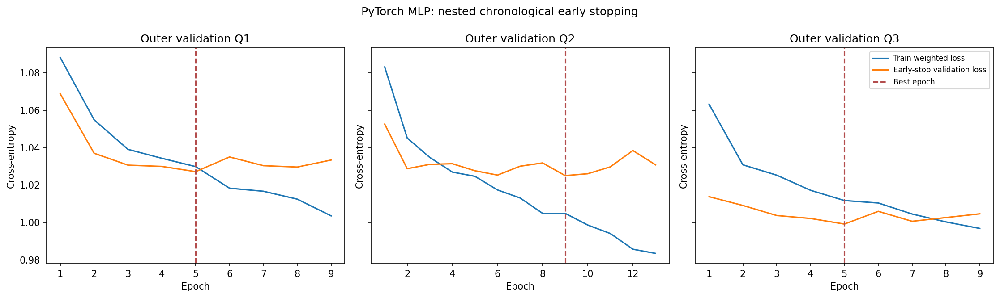

# AccidentIQ — Phase 6: tabular Deep Learning

## Model and training protocol

A compact CPU PyTorch MLP uses 63 engineered inputs, hidden layers 128→64, ReLU activations, dropout 0.25/0.15 and a 3-class output. The objective is class-weighted cross-entropy and the optimizer is Adam (learning rate 0.001, weight decay 0.0001); batch size is 1024. Random seeds are fixed.

The three outer validation windows are 2019 Q2, Q3 and Q4. Each has a fresh preprocessing pipeline. Early stopping uses a second, earlier chronological split drawn only from that fold's training window. The outer validation quarter never selects an epoch. A fresh pipeline is then fit on the outer training window for that fold's best epoch count. Median best epoch across the three folds (5) was used to refit the final model on all 2019 rows. 2020 is held out for comparison; 2021 was not scored.

## Results

| Metric | 2020 validation |
| --- | ---: |
| Accuracy | 0.5547 |
| Macro F1 | 0.3337 |
| Balanced accuracy | 0.4733 |
| Fatal precision / recall | 0.0390 / 0.5945 |
| Serious precision / recall | 0.2358 / 0.1734 |
| Log-loss | 0.9670 |
| Multiclass Brier | 0.5885 |

Outer-fold macro F1 values: 0.3184 (Q2), 0.3482 (Q3), 0.2941 (Q4); mean 0.3202. Fold training windows overlap; this spread is descriptive, not a confidence interval.

The class-weighted MLP raises Fatal recall relative to the unweighted baseline, with very low Fatal precision and lower Serious recall than the balanced tree. Its 2020 macro F1 is below Random Forest's 0.3667. No claim is made that deep learning wins on this small, mostly one-hot tabular feature space.

## Learning notes

- **Forward pass:** dense layers transform each batch; ReLU adds a nonlinear activation and dropout randomly masks hidden activations during training.
- **Loss/backpropagation:** weighted cross-entropy penalizes class errors according to training-fold frequencies. Backpropagation computes gradients from the loss through each layer.
- **Optimizer and learning rate:** Adam updates weights from those gradients; learning rate 0.001 sets the step scale.
- **Epoch and batch size:** one epoch visits the fit rows once; batches of 1024 update parameters incrementally.
- **Overfitting and early stopping:** training loss can continue down while validation loss stalls or rises. The best validation-loss checkpoint is retained, with patience 4.
- **Class imbalance:** weighting raises minority influence but also changes precision and probability calibration. Fatal predictions remain too imprecise for operational alerts.

Full fold loss histories: `fold_histories.json`. Detailed machine-readable metrics: `summary.json` and `comparison.json`. The trusted serialized predictor is ignored at `models/tabular_nn_v1/selected.joblib` and contains both the 2019-fitted preprocessor and model. CPU inference uses normalized probabilities.
