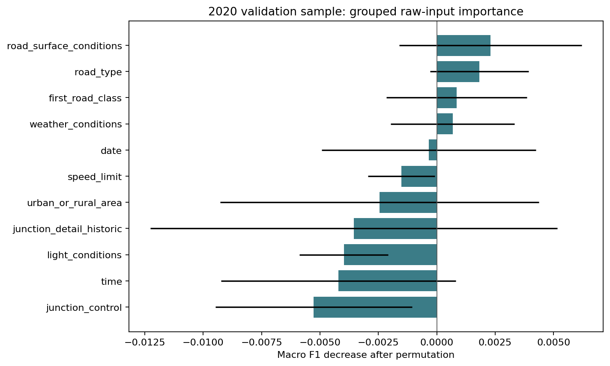

# Phase 10 — Explainability

Frozen model: `random_forest_balanced`. Global permutation importance was computed on a reproducible, class-stratified sample of 2,500 records from the 2020 validation year. It measures the decrease in macro F1 after shuffling each raw input, over three repeats. Rankings can depend on correlated features and this sample; a low value does not prove irrelevance.

## Highest validation-sample permutation effects

| Raw input | Macro F1 decrease | Repeat standard deviation |
| --- | ---: | ---: |
| road_surface_conditions | 0.0023 | 0.0039 |
| road_type | 0.0018 | 0.0021 |
| first_road_class | 0.0008 | 0.0030 |
| weather_conditions | 0.0007 | 0.0027 |

The local example is in `local_sensitivity_example.json`. It replaces one raw feature at a time with a fixed reference (typical 2019 category/speed; noon and July 1 for temporal fields), then records the change in predicted-class probability. API explanations use the same method.

These are model-behavior descriptions, not causal effects. One-at-a-time substitutions may form unrealistic combinations; feature interactions are not fully allocated. The weighted Random Forest's class probabilities are not calibrated confidence. SHAP was not added: raw-feature permutation plus a small, auditable local sensitivity calculation avoids introducing another dependency and makes the comparison baseline explicit.
